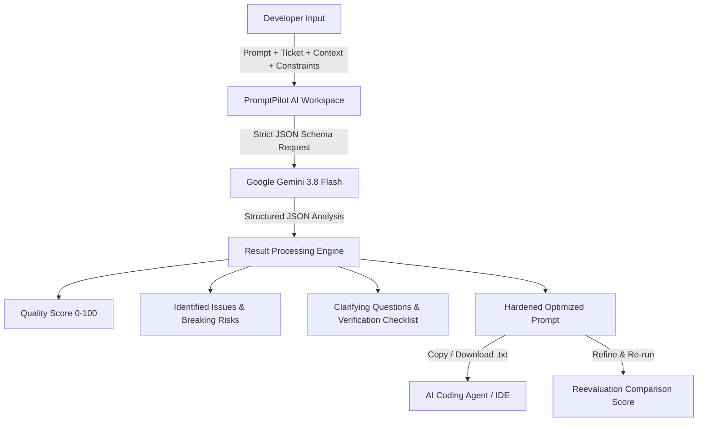

# PromptPilot AI 🚀

> **Intelligent prompt review and optimization workspace for AI coding agents.**  
> Bridge the gap between engineering requirements and AI code generation by auditing prompts against Jira tickets, architectural patterns, developer constraints, and known regression risks using Google Gemini.

---

## 📋 Table of Contents

- [Overview](#overview)
- [Key Features](#key-features)
- [How It Works](#how-it-works)
- [Architecture & Tech Stack](#architecture--tech-stack)
- [Project Structure](#project-structure)
- [Getting Started](#getting-started)
  - [Prerequisites](#prerequisites)
  - [Installation](#installation)
  - [Running Locally](#running-locally)
  - [Building for Production](#building-for-production)
- [Configuring Gemini](#configuring-gemini)
- [Security Notice](#security-notice)
- [Testing & Validation](#testing--validation)
- [License](#license)

---

## 🌟 Overview

When delegating coding tasks to AI agents (such as Cursor, GitHub Copilot, Claude, Devin, or ChatGPT), vague prompts frequently lead to:
- Hallucinated architectural patterns or broken conventions
- Missed edge cases and subtle regression bugs
- Violations of existing API contracts and deep links
- Incomplete implementations that miss core ticket acceptance criteria

**PromptPilot AI** acts as a pre-flight flight-control system for developer prompts. By analyzing an initial prompt alongside the real ticket requirements, existing codebase conventions, constraints, and known edge cases, PromptPilot AI evaluates prompt readiness, surfaces risks, and synthesizes a hardened, fully-contextualized prompt ready for copy-pasting into any coding agent.

---

## ✨ Key Features

- **🎯 Context-Aware Prompt Auditing**: Evaluates prompts across 5 dimensions:
  1. *Original Prompt*: The prompt planned for the coding assistant.
  2. *Ticket / Acceptance Criteria*: Source of truth (Jira, user stories, specs).
  3. *Project Context*: Frameworks, services, libraries, patterns, and conventions.
  4. *Developer Constraints*: Non-negotiables, forbidden changes, performance targets.
  5. *Edge Cases & Regression Risks*: Boundary conditions, deep links, backward compatibility.
- **📊 Heuristic Quality Score (0–100)**: Instant visual feedback on prompt clarity, completeness, and safety.
- **🔍 Deep Structured Intelligence**:
  - **Issues & Severities**: Flagged issues (`critical`, `high`, `medium`, `low`) with concrete mitigation suggestions.
  - **Missing Requirements**: Discrepancies between the ticket and the prompt.
  - **Potential Breaking Risks**: Specific architectural risks that require developer caution.
  - **Clarifying Questions**: Ambiguities to answer before triggering code generation.
  - **Verification Checklist**: Concrete QA and testing checklist to validate generated code.
- **⚡ One-Click Prompt Optimization**: Automatically generates a hardened, production-ready agent prompt incorporating all constraints, tickets, and safety guidelines.
- **🔄 Iterative Reevaluation**: Edit your prompt or optimized prompt and reevaluate to view score progression (e.g., `Score 62/100 ➔ 94/100`).
- **💾 Local History Management**: Full offline-first browser storage (`localStorage`) supporting search, type filtering, sorting, duplication into new drafts, renaming, and deletion.
- **📈 Insightful Dashboard**: Real-time stats on prompts analyzed, prompts optimized, and recent history items with one-click access.
- **🔒 Privacy-First API Key Management**: Session-only in-memory key storage ensures credentials are never written to `localStorage`, session storage, or logs.

---

## 🔄 How It Works



---

## 🛠 Architecture & Tech Stack

| Component | Technology | Purpose |
| :--- | :--- | :--- |
| **Frontend Framework** | [Angular 14](https://angular.io/) | Reactive component architecture, SPA routing, and Reactive Forms |
| **Language** | [TypeScript 4.7](https://www.typescriptlang.org/) | Strongly-typed models, services, and schemas |
| **Styling** | SCSS / CSS Custom Properties | Responsive dark/light themed developer interface |
| **AI Integration** | [`@google/genai`](https://www.npmjs.com/package/@google/genai) | Official Google GenAI SDK for Gemini |
| **Default Model** | `gemini-3.8-flash` | Ultra-fast structured prompt analysis and optimization |
| **Icons** | [`lucide-angular`](https://lucide.dev/) | Clean, lightweight icon suite |
| **Persistence** | Browser `localStorage` | Client-side privacy-first storage for analysis history |

---

## 📁 Project Structure

```text
PromptPilotAI/
├── src/
│   ├── app/
│   │   ├── core/
│   │   │   ├── models/
│   │   │   │   └── prompt-analysis.model.ts   # Core TypeScript interfaces & types
│   │   │   └── services/
│   │   │       ├── gemini.service.ts          # @google/genai SDK integration & schemas
│   │   │       ├── prompt-analysis.service.ts # Orchestrator for analyze/optimize/reevaluate
│   │   │       └── storage.service.ts         # LocalStorage history and draft management
│   │   ├── pages/
│   │   │   ├── dashboard/                     # KPI statistics & recent activity
│   │   │   ├── workspace/                     # Prompt input form, reports, & optimizer
│   │   │   ├── history/                       # Search, filter, duplicate, & export history
│   │   │   └── settings/                      # Gemini API key session configuration & test
│   │   ├── app-routing.module.ts              # Route definitions
│   │   ├── app.component.ts                   # Main navigation & shell layout
│   │   └── app.module.ts                      # Angular NgModule declarations
│   ├── environments/
│   │   ├── environment.ts                     # Dev environment & model configuration
│   │   └── environment.prod.ts                # Production environment
│   ├── styles.scss                            # Global styles, variables, & typography
│   └── main.ts                                # Application bootstrap
├── angular.json                               # Angular CLI configuration
├── package.json                               # Dependencies and scripts
└── tsconfig.json                              # TypeScript compilation options
```

---

## 🚀 Getting Started

### Prerequisites

Ensure you have the following installed on your machine:
- **Node.js**: `v16.14.0` or higher (Node 18 or 20 LTS recommended)
- **npm**: `v8.0.0` or higher
- **Google AI Studio API Key**: [Get a Gemini API Key](https://aistudio.google.com/)

### Installation

1. Clone or navigate into the repository:
   ```bash
   cd PromptPilotAI
   ```

2. Install dependencies:
   ```bash
   npm install
   ```

### Running Locally

Start the Angular development server:
```bash
npm start
# Or: ng serve
```

Navigate to `http://localhost:4200` in your web browser. The app will automatically reload if you change any of the source files.

### Building for Production

Compile the project into production-ready static assets in the `dist/` directory:
```bash
npm run build
```

---

## 🔑 Configuring Gemini

PromptPilot AI supports two ways to configure your Google Gemini API key:

### Method 1: Session-Only Key (Recommended)
1. Open the app and navigate to **Settings** in the top navigation bar.
2. Paste your API key into the **Session-only key** input.
3. Click **Use for this session**.
4. Click **Test connection** to verify connectivity with Gemini.
> **Note:** The key is held strictly in memory for the active browser session. It is never stored in `localStorage`, cookies, exported files, or server logs.

### Method 2: Local Developer Configuration
For local development, you can optionally configure your key in `src/environments/environment.ts`:
```typescript
export const environment = {
  production: false,
  gemini: {
    apiKey: 'YOUR_GEMINI_API_KEY',
    model: 'gemini-3.8-flash'
  }
};
```
> ⚠️ **Warning:** Never commit real API keys into version control!

---

## 🛡️ Security Notice

- **Frontend Proof of Concept (POC)**: PromptPilot AI is currently designed as a client-side POC.
- **Production Guidance**: In a public production deployment, client-side API keys can be inspected in the browser. For enterprise or public deployment, route AI requests through a secured backend server (BFF pattern) to enforce user authentication, role-based access control (RBAC), rate limiting, quota controls, and audit logging.

---

## 🧪 Testing & Validation

- **Production Build Check**:
  ```bash
  npm run build
  ```
- **Unit Testing**:
  ```bash
  npm test
  ```

---

## 💡 Quick Tips for Best Results

- **Click "Load example"** on the Workspace page to quickly test with a realistic invoice-filtering scenario.
- **Provide Project Patterns**: Mentioning frameworks, state management libraries, and architectural rules in "Project Context" drastically improves prompt accuracy.
- **Iterate**: Once Gemini outputs the "Optimized coding-agent prompt", make minor adjustments directly in the textarea and click **Reevaluate** to inspect the upgraded score.
